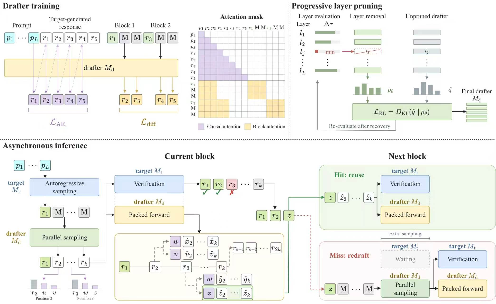

<p align="center">
  <a href="README.md">English</a> | <a href="README.zh-CN.md">简体中文</a>
</p>

<h1 align="center">D3D: Decoupled Diffusion Drafting for Asynchronous Speculative Decoding</h1>

<p align="center">
  <a href="https://huggingface.co/collections/fudan-generative-ai/d3d"></a>
  <a href="#quick-start"></a>
  <a href="https://arxiv.org/abs/2611.06425"></a>
  <a href="docs/architecture.md"></a>
  <a href="#benchmarking"></a>
  <a href="#training-data"></a>
</p>

<a id="overview"></a>

## ✨ 概览

**D3D** 把扩散**草稿模型**与**目标验证模型**解耦到不同的 GPU 上。草稿生成
与目标验证相互重叠，并由验证反馈挑选下一步可复用的候选。

| 异步执行 | 并行扩散草稿 |
|:---|:---|
| 起草与验证分别运行在不同的 GPU 上。 | 按块生成候选，并打包多种接受结果。 |

<p align="center">
  
</p>

**工作方式：** 目标模型选出的 anchor 触发一次并行扩散起草；在草稿 GPU 准备
后续候选的同时，目标模型验证当前块；验证反馈决定复用哪一个候选。执行流程
见[架构文档](docs/architecture.md)。

<a id="model-zoo"></a>

## 🤗 模型仓库

**[浏览 D3D 合集 →](https://huggingface.co/collections/fudan-generative-ai/d3d)**

六个 Qwen3 派生的草稿 checkpoint 收录在
[D3D 合集](https://huggingface.co/collections/fudan-generative-ai/d3d)中。
它们是**草稿模型**，不是目标模型的替代品。名称中的 `p` 表示剪枝，`24D` 与
`31D` 表示保留的 transformer 层数。

| 目标验证模型 | 草稿系列 | 层数 | D3D checkpoint |
|:---|:---|:---:|:---|
| [Qwen3-8B](https://huggingface.co/Qwen/Qwen3-8B) | 1.7B | 28 | [D3D-1.7B-8B](https://huggingface.co/fudan-generative-ai/D3D-1.7B-8B) |
| [Qwen3-8B](https://huggingface.co/Qwen/Qwen3-8B) | 8B | 36 | [D3D-8B-8B](https://huggingface.co/fudan-generative-ai/D3D-8B-8B) |
| [Qwen3-8B](https://huggingface.co/Qwen/Qwen3-8B) | 剪枝 8B | 31 | [D3D-31D-p8B-8B](https://huggingface.co/fudan-generative-ai/D3D-31D-p8B-8B) |
| [Qwen3-32B](https://huggingface.co/Qwen/Qwen3-32B) | 1.7B | 28 | [D3D-1.7B-32B](https://huggingface.co/fudan-generative-ai/D3D-1.7B-32B) |
| [Qwen3-32B](https://huggingface.co/Qwen/Qwen3-32B) | 8B | 36 | [D3D-8B-32B](https://huggingface.co/fudan-generative-ai/D3D-8B-32B) |
| [Qwen3-32B](https://huggingface.co/Qwen/Qwen3-32B) | 剪枝 1.7B | 24 | [D3D-24D-p1.7B-32B](https://huggingface.co/fudan-generative-ai/D3D-24D-p1.7B-32B) |

<a id="installation"></a>

## 📦 安装

训练、层剪枝与原生推理统一使用 **PyTorch 2.8.0**、**Transformers 4.57.3**、
**FlashAttention 2.8.3** 与 **CUDA 12.8**；支持 Python 3.10+。验证使用 Python
3.12 和两张 NVIDIA H800 80 GB；依赖版本与检查项见
[environment.md](docs/environment.md)。

```bash
git clone https://github.com/fudan-generative-vision/D3D.git
cd D3D
python -m venv .venv
source .venv/bin/activate
pip install -r requirements.txt
pip install flash-attn==2.8.3 --no-build-isolation
pip install -e . --no-deps
```

<a id="quick-start"></a>

## 🚀 快速开始

### 1. 目标模型与草稿模型配置

```bash
export CUDA_VISIBLE_DEVICES=0,1

# 可选：覆盖所有脚本的默认模型
export TARGET_MODEL=Qwen/Qwen3-8B
export DRAFT_MODEL=fudan-generative-ai/D3D-1.7B-8B
```

目标模型运行在 `cuda:0`，草稿模型运行在 `cuda:1`。模型 ID 也接受本地
checkpoint 目录。下载公开模型不需要 Hugging Face token。

### 2. 运行异步解码

每个脚本都会把多余参数透传给对应的 Python 入口，因此优先用命令行参数，
少用环境变量。单请求脚本用 `--verifier` / `--drafter`，并发脚本用
`--target` / `--draft`。

**单请求** —— 一条 MATH-500 样本，最多生成 128 个 token：

```bash
bash scripts/quickstart_single.sh

# 例如换一对模型并放宽生成长度
bash scripts/quickstart_single.sh \
    --verifier Qwen/Qwen3-32B \
    --drafter fudan-generative-ai/D3D-24D-p1.7B-32B \
    --max-new-tokens 512
```

**并发请求** —— 四请求并发 4：

```bash
bash scripts/quickstart_concurrent.sh

# 例如并发 8、每卡 256 个 KV page
CONCURRENCY=8 bash scripts/quickstart_concurrent.sh --pages 256
```

<details>
<summary><strong>使用 32B 目标 + 24 层剪枝草稿</strong></summary>

```bash
bash scripts/quickstart_single.sh \
    --verifier Qwen/Qwen3-32B \
    --drafter fudan-generative-ai/D3D-24D-p1.7B-32B

bash scripts/quickstart_concurrent.sh \
    --target Qwen/Qwen3-32B \
    --draft fudan-generative-ai/D3D-24D-p1.7B-32B \
    --concurrency 4 --pages 128
```

</details>

<details>
<summary><strong>常用配置项</strong></summary>

脚本把默认值当参数传给入口，命令行上追加的参数优先。只剩少数环境变量：

| 变量 | 作用 | 默认值 |
|:---|:---|:---|
| `TARGET_MODEL` | 所有脚本使用的目标验证模型 | `Qwen/Qwen3-8B` |
| `DRAFT_MODEL` | 所有脚本使用的草稿 checkpoint | `fudan-generative-ai/D3D-1.7B-8B` |
| `DATASETS` | 两个 benchmark 脚本的数据集列表 | 七个标准数据集 |
| `CONCURRENCY` | quick start 的请求数，或并发 benchmark 的扫描列表 | `4` / `1 4 8 16` |
| `D3D_DATA_CACHE` | 可选的本地 jsonl 数据集缓存 | `data_cache/` |

其余都是命令行参数，例如 `--max-samples`、`--max-new-tokens`、`--block-size`、
`--anchor-num`、`--pages`、`--no-baseline`。

单请求的完整参数用 `python single/eval_async_packed.py --help` 查看，并发用
`python -m serving.bench --help`。

</details>

<a id="benchmarking"></a>

## 📊 性能基准

在标准数据集上运行单请求评测：

```bash
bash scripts/benchmark.sh
```

在并发 1、4、8、16 下运行并发评测：

```bash
bash scripts/benchmark_concurrent.sh
```

数据集在运行时下载，不随仓库分发。LiveCodeBench v6 使用
`livecodebench/code_generation_lite` 的 `test6.jsonl`，其余数据集使用
`datasets`。来源、split、token 上限、计时边界与上报规则见
[benchmark 协议](benchmarks/README.md)。

## ⚙️ 推理引擎支持

仓库支持原生 D3D 推理，也提供可选的双卡 SGLang Hybrid 后端。
部署方式见 [SGLang backend](docs/sglang-backend.md)。请单独安装：

```bash
bash scripts/sglang/install.sh
```

启动双卡后端（GPU 0：Target + 本地 Draft；GPU 1：备选 Draft）：

```bash
export TARGET_MODEL=Qwen/Qwen3-8B
export DRAFT_MODEL=fudan-generative-ai/D3D-1.7B-8B
export TARGET_GPU=0 DRAFT_GPU=1
export MAX_RUNNING_REQUESTS=1
bash scripts/sglang/launch.sh hybrid
```

然后在另一个终端运行 MATH-500 评测：

```bash
export MAX_RUNNING_REQUESTS=1
export TARGET_MODEL=Qwen/Qwen3-8B
.venv-sglang/bin/python scripts/sglang/benchmark.py \
  --dataset math500 \
  --tokenizer "$TARGET_MODEL" \
  --samples 128 --concurrency "$MAX_RUNNING_REQUESTS" \
  --repetitions 1 --max-new-tokens 512 \
  --output outputs/sglang/example.json
```

数据集会自动下载，并由 Hugging Face Datasets 缓存。

在两个终端中将 `MAX_RUNNING_REQUESTS` 统一设为 `1`、`4`、`8` 或 `16`；
修改后需重启后端。

**SGLang Hybrid 在七个测试集全集上的吞吐。**

D3D-1.7B → Qwen3-8B，单并发，`anchor_num=1`，block size 16，
`max_new_tokens=512`，贪心解码，关闭 thinking，EOS 正常生效。

| 数据集 | tokens/s（speedup） |
|---|---:|
| GSM8K | 658.10 (4.876×) |
| MATH-500 | 572.66 (4.243×) |
| AIME25 | 394.56 (2.924×) |
| HumanEval | 479.15 (3.550×) |
| MBPP | 428.39 (3.174×) |
| LCB-v6 | 267.42 (1.982×) |
| MT-Bench | 258.54 (1.916×) |
| **合并统计** | **501.60 (3.717×)** |

<a id="training-data"></a>

## 📚 训练数据

所有语料均使用 [Open-PerfectBlend](https://huggingface.co/datasets/mlabonne/open-perfectblend)
的 prompt。生成参数、统计信息与下载方式见各数据集的 dataset card。已发布的模型和数据集
见 [D3D collection](https://huggingface.co/collections/fudan-generative-ai/d3d)。

| 语料 | Target Model | Samples | 数据集 |
|:---|:---|---:|:---|
| **PerfectBlend: Qwen3.8-27B Thinking** | [Qwen3.8-27B](https://huggingface.co/Qwen/Qwen3.8-27B) | 1,417,675 | [PerfectBlend-Qwen3.8-27B-Thinking](https://huggingface.co/datasets/fudan-generative-ai/PerfectBlend-Qwen3.8-27B-Thinking) |
| **PerfectBlend: Qwen3-4B Thinking (Greedy)** | [Qwen3-4B](https://huggingface.co/Qwen/Qwen3-4B) | 1,420,909 | [PerfectBlend-Qwen3-4B-Thinking-Greedy](https://huggingface.co/datasets/fudan-generative-ai/PerfectBlend-Qwen3-4B-Thinking-Greedy) |
| **PerfectBlend: Qwen3-4B NoThink (Greedy)** | [Qwen3-4B](https://huggingface.co/Qwen/Qwen3-4B) | 1,420,908 | [PerfectBlend-Qwen3-4B-NoThink-Greedy](https://huggingface.co/datasets/fudan-generative-ai/PerfectBlend-Qwen3-4B-NoThink-Greedy) |
| **PerfectBlend: Qwen3-4B NoThink (Sampling)** | [Qwen3-4B](https://huggingface.co/Qwen/Qwen3-4B) | 1,420,909 | [PerfectBlend-Qwen3-4B-NoThink-Sampling](https://huggingface.co/datasets/fudan-generative-ai/PerfectBlend-Qwen3-4B-NoThink-Sampling) |
| **PerfectBlend: Qwen3-8B NoThink (Greedy)** | [Qwen3-8B](https://huggingface.co/Qwen/Qwen3-8B) | 1,420,908 | [PerfectBlend-Qwen3-8B-NoThink-Greedy](https://huggingface.co/datasets/fudan-generative-ai/PerfectBlend-Qwen3-8B-NoThink-Greedy) |
| **PerfectBlend: Qwen3-8B NoThink (Sampling)** | [Qwen3-8B](https://huggingface.co/Qwen/Qwen3-8B) | 1,420,909 | [PerfectBlend-Qwen3-8B-NoThink-Sampling](https://huggingface.co/datasets/fudan-generative-ai/PerfectBlend-Qwen3-8B-NoThink-Sampling) |
| **PerfectBlend: Qwen3-32B NoThink (Sampling)** | [Qwen3-32B](https://huggingface.co/Qwen/Qwen3-32B) | 1,420,500 | [PerfectBlend-Qwen3-32B-NoThink-Sampling](https://huggingface.co/datasets/fudan-generative-ai/PerfectBlend-Qwen3-32B-NoThink-Sampling) |
| **PerfectBlend: Gemma-4-12B-IT (Greedy)** | [Gemma-4-12B-IT](https://huggingface.co/google/gemma-4-12B-it) | 1,420,898 | [PerfectBlend-Gemma-4-12B-IT-Greedy](https://huggingface.co/datasets/fudan-generative-ai/PerfectBlend-Gemma-4-12B-IT-Greedy) |
| **PerfectBlend: Gemma-4-31B-IT (Greedy)** | [Gemma-4-31B-IT](https://huggingface.co/google/gemma-4-31B-it) | 1,420,903 | [PerfectBlend-Gemma-4-31B-IT-Greedy](https://huggingface.co/datasets/fudan-generative-ai/PerfectBlend-Gemma-4-31B-IT-Greedy) |

每个语料对应其列出的模型；训练时请使用匹配的 tokenizer。

## 🏋️ 训练与层剪枝

训练代码位于 `train/` 和 `pruning/`，包括基于 target 生成回答的离线训练、
层选择、物理剪枝、恢复训练和恢复 checkpoint 选择。

训练与原生推理使用上面通过 `requirements.txt` 安装的**同一环境**。

```bash
export DRAFT_MODEL=checkpoints/Qwen3-1.7B
export TARGET_MODEL=checkpoints/Qwen3-8B
export DATA_PATH=data/train.jsonl
CUDA_VISIBLE_DEVICES=0,1 NUM_GPUS=2 bash scripts/train.sh \
    --attn-implementation sdpa --disable-wandb
```

请先下载初始模型并准备 jsonl 数据。安装方法、数据格式、损失设置与四阶段剪枝命令见
[训练与渐进式剪枝指南](docs/training.md)。

## 引用

如果使用 D3D，请引用：

```bibtex
@article{chen2026d3d,
  title   = {D3D: Decoupled Diffusion Drafting for Asynchronous Speculative Decoding},
  author  = {Baoyou Chen and Ruiqiao Mei and Guancong Lin and Tao Song and Weihao Yuan and Qun Liu and Siyu Zhu},
  journal = {arXiv preprint arXiv:2611.06425},
  year    = {2026}
}
```
